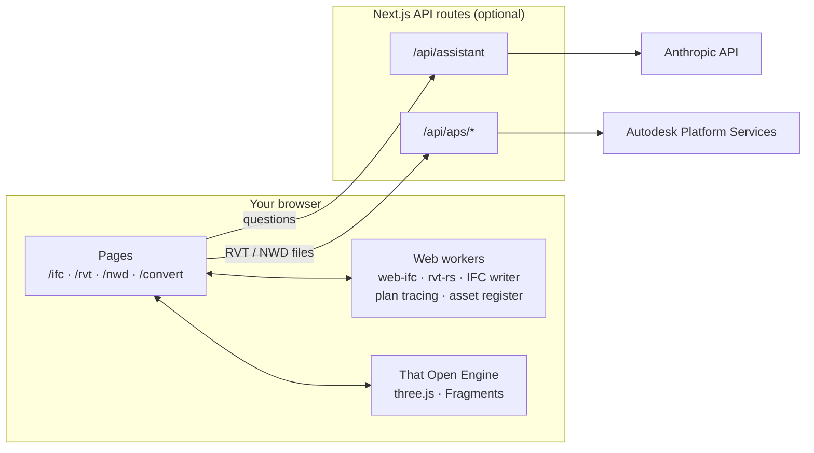

<div align="center">

# bim-os

**An open-source BIM workbench that runs in your browser.**

View and analyse IFC models, bring in Revit and Navisworks, convert models and floor plans to IFC,<br>
and hand over asset data (COBie, asset registers, single-line diagrams) for facilities management.

[](LICENSE)
[](https://nodejs.org)
[](https://nextjs.org)
[](https://www.typescriptlang.org)
[](https://github.com/ThatOpen)
[](CONTRIBUTING.md)

[Features](#features) · [Quick start](#quick-start) · [Configuration](#configuration) · [Documentation](#documentation) · [Contributing](#contributing) · [License](#license)

</div>

---

bim-os is a local-first web app for working with building information models. IFC files are opened, analysed and converted on your own machine, in WebAssembly and web workers; nothing is uploaded unless you choose one of the optional cloud routes (Autodesk Platform Services for Revit and Navisworks, or the AI assistant with your own API key).

> [!NOTE]
> bim-os was developed under the name *IFC Studio*. The app's header, the viewer extractor and the IFC property sets it writes (`IFCStudio_*`) still use that name; see [Development notes](docs/development.md#names-left-from-ifc-studio).

## Features

### IFC viewer and model analysis (`/ifc`)

- Opens IFC2x3, IFC4 and IFC4x3 as `.ifc`, ifcZIP (`.ifczip`, including ZIP64) and Fragments (`.frag`): single files, several at once, or a whole project folder, with duplicate copies and extracts spotted and left out.
- Large models are streamed through [web-ifc](https://github.com/ThatOpen/engine_web-ifc) in a worker and drawn with That Open's Fragments engine (tested up to a 612 MB, 450,000-element file).
- Select, hide, isolate and X-ray; measure length, area, angle and volume; section planes and storey plans; orbit, first-person and plan navigation; three render styles.
- Analysis panels: spatial tree, rule-based search, grouping and colouring, quantity take-off with CSV export, sixteen data-quality checks, clash detection, [buildingSMART IDS](https://www.buildingsmart.org/standards/bsi-standards/information-delivery-specification-ids/) validation (290 of the 307 official test cases pass), and an optional AI assistant whose answers come from the loaded model.
- Exports whole models or selections as Fragments, selections as valid IFC subsets, and several models as one combined `.frag` or a `.zip` of `.frag` files.

### Revit and Navisworks (`/rvt`, `/nwd`)

- Revit files are read in the browser by the open-source [rvt-rs](https://github.com/DrunkOnJava/rvt-rs) reader (experimental, nothing uploaded), or exactly through Autodesk Platform Services and Revit's own IFC exporter.
- Navisworks models are shown in Autodesk's viewer through Autodesk Platform Services, with selection at three levels, grouping, search, and IFC export of the selection, the visible objects or the whole model.

### Convert to IFC (`/convert`)

- Builds IFC4 files from Revit and Navisworks models, models shared in the Autodesk Viewer (read on the viewer page by a bookmarklet), floor-plan PDFs and images, or a mix of them.
- One IFC per discipline plus a federated model, sharing GlobalIds, site and storeys, so the files line up.
- IFC classes and predefined types from Revit categories and family names, Revit GUIDs kept as GlobalIds, type objects, materials, surface styles, textures and vertex colours, and shared shapes written once.
- Floor plans: set the scale, align, trace walls and the slab, correct them, and write IfcWall and IfcSlab.
- A 3D preview with materials and textures before anything is generated.

### Asset information for facilities management

- An asset register of the model's maintainable equipment: make, model, serial number, tag, installation date, warranty, expected life, PPM, room, systems, and what serves what.
- Electrical distribution as a board hierarchy with circuits and loads, drawn as single-line diagrams.
- MEP technical data converted to one unit per field, and fire and life-safety data (panels, loops, zones, ratings).
- About 140 asset kinds with short codes, suggested Uniclass 2015 classes and compliance groups, plus location and asset codes from a pattern you set.
- Three outputs: a COBie 2.4 workbook, an asset-register workbook and single-line diagrams (HTML). The same data can also be written into the IFC files (Pset_ManufacturerTypeInformation, Pset_Warranty, Pset_ServiceLife, systems and zones).

### Command line

- `npm run convert` turns IFC files, ifcZIP archives or whole folders into Fragments outside the browser.
- `npm run combine` joins `.frag` files into one.

## How it works

bim-os is a [Next.js](https://nextjs.org) 16 app (React 19, TypeScript, Tailwind CSS). Viewing is done by [That Open Engine](https://github.com/ThatOpen) on [three.js](https://threejs.org); IFC parsing is done by web-ifc. Heavy work (converting, writing IFC, tracing plans, building the asset register) runs in web workers. The only server code is a small set of API routes that call Autodesk Platform Services and the Anthropic API with keys kept on the server.



## Quick start

You need [Node.js](https://nodejs.org) 20.9 or newer and npm. bim-os has been tested in Chromium-based browsers (Chrome, Edge).

```bash
git clone https://github.com/khjabir/bim-os.git
cd bim-os
npm install
npm run dev
```

Open <http://localhost:3000>. The IFC viewer, the analysis tools, the in-browser Revit reader, floor-plan conversion and the Autodesk Viewer extractor work without any keys.

For a production build:

```bash
npm run build
npm start
```

## Configuration

Everything is optional. Copy `.env.example` to `.env.local`, fill in what you need and restart the server. The values are read only by the server-side API routes and never reach the browser.

| Variable | Used for |
| --- | --- |
| `ANTHROPIC_API_KEY` | The AI assistant in the IFC and RVT viewers. `ANTHROPIC_MODEL` picks the model (default `claude-sonnet-5-5`). |
| `APS_CLIENT_ID`, `APS_CLIENT_SECRET` | Revit cloud conversion, the Navisworks viewer and the cloud routes of the Convert page. Create an app at <https://aps.autodesk.com> with the Data Management and Model Derivative APIs. |
| `APS_REGION` | Where uploads are stored: `US` (default), `EMEA`, `AUS`, `CAN`, `DEU`, `IND`, `JPN` or `GBR`. The Navisworks viewer is set up for `US`, `EMEA` and `AUS`. |
| `APS_BUCKET` | A bucket name of your own. By default one is derived from the client id; uploads are kept for 24 hours. |

> [!WARNING]
> The API routes spend your API credit and cloud quota. They accept requests from the app's own pages only, which suits running bim-os on your own machine. Put real authentication in front of them before hosting it anywhere others can reach.

## Scripts

| Command | What it does |
| --- | --- |
| `npm run dev` | Development server on port 3000 |
| `npm run build`, `npm start` | Production build and server |
| `npm run typecheck` | TypeScript check |
| `npm run convert -- <file or folder>` | Converts IFC and ifcZIP files to Fragments on the command line (`--combined all.frag` also joins a folder's models into one file) |
| `npm run combine -- a.frag b.frag -o all.frag` | Joins Fragments files into one |
| `npm run assets` | Copies the web-ifc, Fragments and pdf.js workers into `public/` (also runs on install, dev and build) |
| `npm run build:rvt-wasm` | Rebuilds the in-browser Revit reader from rvt-rs (needs Rust) |

## Documentation

| Page | Contents |
| --- | --- |
| [IFC viewer](docs/ifc-viewer.md) | Opening files, large models, ifcZIP, project folders, exports, the combined file, the command line, tools and panels |
| [Revit and Navisworks](docs/revit-and-navisworks.md) | The in-browser Revit reader, the Autodesk cloud route and the Navisworks viewer |
| [Convert to IFC](docs/convert.md) | Sources, Autodesk Viewer links, floor plans, assembling, generating, materials and textures |
| [Asset register](docs/asset-register.md) | What is read for each asset, electrical distribution, technical and fire data, codes, and the COBie, register and diagram outputs |
| [Development notes](docs/development.md) | Project layout, pinned dependency versions, rebuilding the Revit reader, names left from IFC Studio |
| [Testing and known limits](docs/testing.md) | What has been tested, with which models, and what has not |

## Project layout

```
src/app/          Pages (/ifc, /rvt, /nwd, /convert) and API routes (/api/assistant, /api/aps/*)
src/components/   The interface: viewer, Navisworks page, Convert page, charts, shared UI
src/lib/          Engine, IFC worker, analysis, assistant, Revit and Autodesk clients, IFC writers,
                  converter (with the asset register in convert/assets/) and utilities
public/           The viewer extractor, the rvt-rs WebAssembly reader and sample files
scripts/          Asset copy, command-line converter and combiner, rvt-rs rebuild
docs/             Documentation
```

A fuller map is in [Development notes](docs/development.md#project-layout).

## Status

bim-os is at version 0.1 and changes quickly. Things to know before relying on it:

- Reading Revit files in the browser is experimental: rvt-rs recovers part of a project, with simplified shapes and incomplete parameters. Do not measure or coordinate from that view.
- The Autodesk Platform Services routes and the AI assistant were tested against stand-ins, not the live services.
- Models converted from Autodesk viewer data keep the viewer's triangles; parametric solids cannot be recovered from it.
- Very large federated projects are limited by the memory a browser tab can use; the [IFC viewer docs](docs/ifc-viewer.md#how-much-a-folder-can-hold) give measured figures.
- Only Chromium-based browsers have been tested.

[Testing and known limits](docs/testing.md) has the details.

## Contributing

Bug reports, sample files that break something (if you may share them), fixes, features and documentation are all welcome. Read [CONTRIBUTING.md](CONTRIBUTING.md) to get started, and follow the [Code of Conduct](CODE_OF_CONDUCT.md). To report a security problem, see [SECURITY.md](SECURITY.md) instead of opening an issue.

## Acknowledgements

bim-os stands on these projects:

| Project | Used for | Licence |
| --- | --- | --- |
| [That Open Engine](https://github.com/ThatOpen) (components, components-front, fragments) | Viewer engine and the Fragments format | MIT |
| [web-ifc](https://github.com/ThatOpen/engine_web-ifc) | Reading IFC (WebAssembly) | MPL-2.0 |
| [three.js](https://threejs.org), [three-mesh-bvh](https://github.com/gkjohnson/three-mesh-bvh), [camera-controls](https://github.com/yomotsu/camera-controls) | 3D rendering, picking and navigation | MIT |
| [rvt-rs](https://github.com/DrunkOnJava/rvt-rs) 0.17.0 | In-browser Revit reader, vendored in `public/rvt/` with its licence, notice and crate list | Apache-2.0 |
| [pdf.js](https://github.com/mozilla/pdf.js) | Floor-plan PDFs | Apache-2.0 |
| [FlatBuffers](https://github.com/google/flatbuffers) | Writing combined Fragments files | Apache-2.0 |
| [Anthropic TypeScript SDK](https://github.com/anthropics/anthropic-sdk-typescript) | The AI assistant | Apache-2.0 |
| [Next.js](https://nextjs.org), [React](https://react.dev), [Tailwind CSS](https://tailwindcss.com), [Zustand](https://github.com/pmndrs/zustand), [TanStack Virtual](https://tanstack.com/virtual), [Lucide](https://lucide.dev) | App framework and interface | MIT (Lucide: ISC) |

- The Autodesk viewer and Autodesk Platform Services are Autodesk's proprietary software and services. They are not part of this repository: the viewer is loaded from Autodesk's servers, and using either is subject to Autodesk's terms.
- The sample model in `public/samples/lmv-shaver/` comes from Autodesk's `viewer-javascript-offline.sample` repository (MIT, licence included).
- IFC and IDS are open standards of [buildingSMART International](https://www.buildingsmart.org). Uniclass 2015 codes and titles are © [NBS](https://uniclass.thenbs.com).

Autodesk, Revit and Navisworks are registered trademarks of Autodesk, Inc. bim-os is not affiliated with or endorsed by Autodesk, buildingSMART, That Open Company or NBS.

## License

bim-os is released under the [MIT License](LICENSE). Third-party components keep their own licences, listed above.
